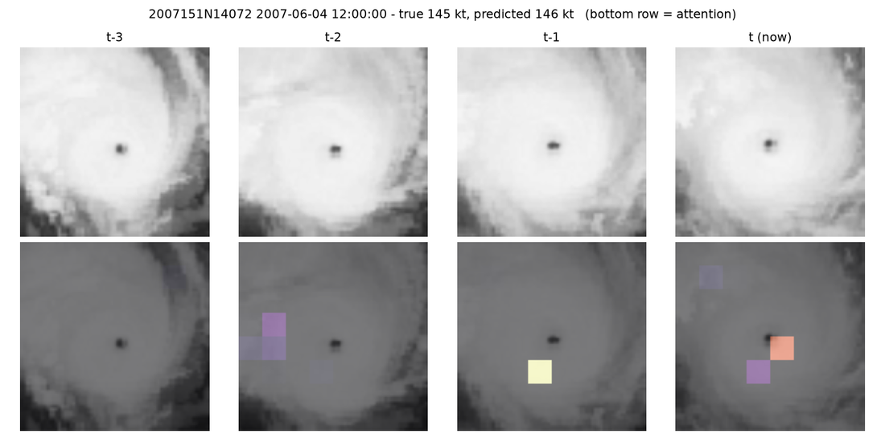
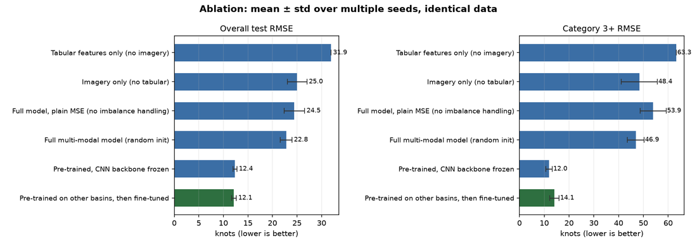

<div align="center">

# Cyclone Intensity Estimation — North Indian Ocean

**Predicting tropical cyclone wind speed from satellite imagery**, for the
Arabian Sea and Bay of Bengal — where no aircraft flies into the storm.

[](https://www.python.org)
[](https://pytorch.org)
[](https://www.ncei.noaa.gov)
[](LICENSE)

**12.15 kt RMSE** &nbsp;·&nbsp; down from a 35.65 kt baseline &nbsp;·&nbsp;
2.1 M parameters &nbsp;·&nbsp; trains in minutes on one consumer GPU

</div>

---

<div align="center">
  
  <p><em>Cyclone Gonu at peak intensity — true <b>145 kt</b>, predicted
  <b>146 kt</b>. Top: infrared frames over twelve hours. Bottom: where the
  model looked. No supervision was applied to the attention weights.</em></p>
</div>

---

## The problem

In the Atlantic, a plane flies into the storm and measures the wind directly.
In the North Indian Ocean that never happens — satellite imagery is often the
only look at a storm's core. So intensity is estimated by eye using the
**Dvorak technique**, a manual pattern-matching procedure from 1975 whose
output varies between analysts.

This basin also produces the deadliest cyclones on record, because the Bay of
Bengal funnels storm surge into dense, low-lying coastline.

## The model

```
4 infrared frames (12 h) ──► CNN backbone ─┬─► pooled ──► LSTM ──► state h
                                           │                        │
                                           └─► 4×8×8 patch tokens   │
                                                        │           │
                                     h queries patches ─┴───────────┘
                                                        │
                                        cross-attention ▼
                                            context + attention map
                                                        │
lat · lon · month · motion ──► MLP ─────────► concat ───┴──► wind speed (kt)
```

2.1 M parameters, written from scratch. No pre-trained image classifier is used
as a backbone — the transfer weights come from this same architecture trained
on other basins.

**Why four frames and not one.** A storm whose eye has been contracting for
nine hours and one whose eye is filling can look nearly identical in a single
snapshot. The twelve-hour sequence is what separates them.

**Why attention over patches and not time steps.** Attending over four time
steps gives four numbers. Attending over all 4 × 8 × 8 patches gives a map you
can overlay on the imagery — the figure above.

## Results

Every configuration run with **five random seeds**; mean ± std. Welch's
*t*-test against the full model.

| Model | Test RMSE (kt) | Cat 3+ RMSE (kt) | Cat 3+ bias (kt) |
|:---|---:|---:|---:|
| Predict-the-mean baseline | 35.65 | — | — |
| Position & season only | 31.95 ± 0.00 | 63.30 ± 0.00 | −61.50 |
| Imagery only | 25.03 ± 2.00 | 48.38 ± 7.25 | −44.63 |
| Full model, trained locally | 22.79 ± 1.19 | 46.91 ± 3.36 | −42.52 |
| Pre-trained, backbone frozen | 12.36 ± 0.41 | **11.97 ± 1.29** | **−4.25** |
| **Pre-trained, fine-tuned** | **12.15 ± 0.50** | 14.09 ± 1.93 | −7.17 |

<div align="center">
  
</div>

### The wall, and how it came down

Trained only on local data the model reaches 22.79 kt — a real improvement over
the baseline — but its Category 3+ **bias equals its MAE in magnitude**, which
means every one of the 52 severe test observations was under-predicted. Gonu
peaked at 145 kt; that model called it around 100.

Category 3+ observations are **4.5%** of this basin's record. Weighted loss,
balanced sampling and a tighter crop were all tried; none of them creates
severe-storm examples that do not exist.

The fix was to borrow them. Pre-training on **14,302 frames from 264 storms**
in the Atlantic and Pacific, where Category 4–5 is routine, then fine-tuning
locally:

> **22.79 → 12.15 kt**, p = 4.8 × 10⁻⁶ · Category 3+ bias **−42.5 → −7.2 kt**

### The finding

Freezing the transferred CNN **entirely** is statistically indistinguishable
from fine-tuning it (12.36 vs 12.15 kt, p = 0.49), and is slightly better on
severe storms. The visual signature of a dangerous cyclone appears to be
largely basin-independent — an eye is an eye, whichever ocean it sits over.

### Checked for leakage, three ways

An improvement that size invites suspicion, so the pre-training set was audited
by storm identifier, by name and season, and by geographic position. Of 14,302
pre-training frames, **zero** fall inside the North Indian Ocean bounding box.
A storm can be renamed or renumbered between archive versions — it cannot be
relocated.

## Data

| Source | Role |
|:---|:---|
| [IBTrACS v04r01](https://www.ncei.noaa.gov/products/international-best-track-archive) | best-track labels (`USA_WIND`, position, time) |
| [HURSAT-B1 v06](https://www.ncei.noaa.gov/products/hurricane-satellite-data) | storm-centred 11 µm infrared imagery |

48 storms · 2,341 labelled frames · 2000–2015 · 40,807 source files processed.
Both archives are US government works in the public domain. No Kaggle dataset
and no synthetic data are used.

> **The split is storm-disjoint.** Consecutive frames are three hours apart and
> visually near-identical, so a random split over frames would put almost the
> same image in training and test. Whole storms go to one side or the other.

## Run it

### Reproduce the results in two minutes, no training

**[Download the runnable bundle (109 MB)](https://drive.google.com/file/d/1sWiXUPsi5kEDgiKP_hz2mFNT_cbhGjM4/view?usp=sharing)**
— processed frames, trained checkpoints and every figure.

```bash
unzip cyclone_share.zip && cd cyclone_share
pip install -r requirements.txt
python evaluate.py          # per-band metrics, lifecycle curves, attention maps
python check_leakage.py     # the three-way leakage audit
```

### Test the pipeline with no data at all

```bash
pip install -r requirements.txt
python make_fake_data.py    # synthetic storms in the same format
python train.py --epochs 3
```

### Build everything from the archives

```bash
python step1_get_ibtracs.py      # labels
python step3_get_hursat.py       # imagery (several GB)
python step4_build_dataset.py    # -> data/processed/manifest.csv
python train.py --init-from checkpoints/pretrained.pt --epochs 60 --balance 0.5
```

<details>
<summary><b>Repository layout</b></summary>

<br>

| File | What it does |
|:---|:---|
| `step1_get_ibtracs.py` | downloads the best-track labels |
| `step2_explore_tracks.py` | cleans tracks, builds tabular features |
| `step3_get_hursat.py` | downloads satellite imagery by storm ID |
| `step4_build_dataset.py` | netCDF to 128x128 frames + manifest |
| `step6_build_global.py` | builds the other-basin pre-training set |
| `dataset.py` | sequence windows, storm-disjoint split, augmentation |
| `model.py` | the architecture and the weighted MSE loss |
| `pretrain.py` / `train.py` | the two training stages |
| `evaluate.py` | per-band metrics, lifecycle curves, attention maps |
| `check_leakage.py` | three-way leakage audit |
| `repeat_runs.py` | multi-seed runs with mean ± std |
| `make_ablation_table.py` | the ablation table and chart |
| `make_fake_data.py` | synthetic data for testing without downloads |
| `sweep_crop.py` | controlled input-resolution study |

</details>

<details>
<summary><b>Training details</b></summary>

<br>

| Setting | Value |
|:---|:---|
| Optimizer | AdamW, lr 3 × 10⁻⁴, weight decay 1 × 10⁻⁴ |
| Schedule | linear warm-up, then cosine decay |
| Batch size | 16 |
| Epochs | 60, early stopping (patience 8) |
| Loss | Weighted MSE, ramps 1× to 3× around 96 kt |
| Sampling | intensity-balanced, power 0.5 |
| Augmentation | random 90° rotation — **no mirror flips** |
| Input | 4 frames, 128 × 128, 8.8 km per pixel |

Mirror flips are excluded deliberately: reflection reverses the direction of
rotation, which is fixed by the Coriolis force in the Northern Hemisphere.

</details>

## Limitations

- The public HURSAT-B1 release ends in **2015**, so Tauktae (2021) and Biparjoy
  (2023) cannot be evaluated.
- Of 90 storms in the best-track record for the period, **48** had usable
  imagery.
- IBTrACS `USA_WIND` in this basin is itself largely **Dvorak-derived**, so the
  model is partly learning to reproduce the Dvorak technique rather than being
  trained against independent ground truth.
- The ERA5 environmental branch (SST, vertical wind shear) is specified in the
  design but **not implemented**.
- **This is a course project and is not validated for operational use.**

## Citation

```bibtex
@misc{jameel2026cyclone,
  author = {Jameel, Junaid},
  title  = {Multi-Modal Tropical Cyclone Intensity Estimation
            in the North Indian Ocean},
  year   = {2026},
  note   = {Deep Learning course project, NED University of Engineering
            and Technology},
  howpublished = {\url{https://github.com/Junaidjameel773/cyclone-intensity-nio}}
}
```

---

<div align="center">

Deep Learning course project · MS Artificial Intelligence<br>
**NED University of Engineering and Technology**

Data courtesy of NOAA NCEI — IBTrACS (Knapp et al., 2010; Gahtan et al., 2024)
and HURSAT-B1 (Knapp &amp; Kossin, 2007).

</div>
